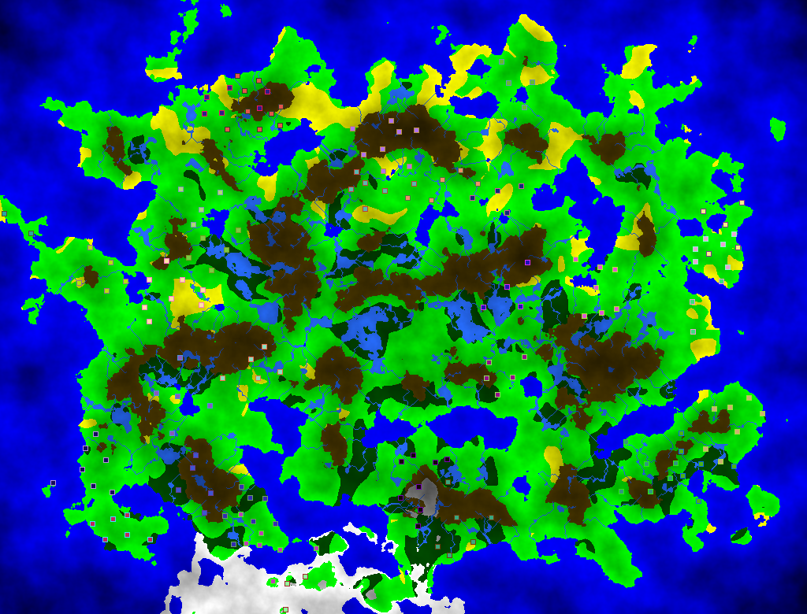
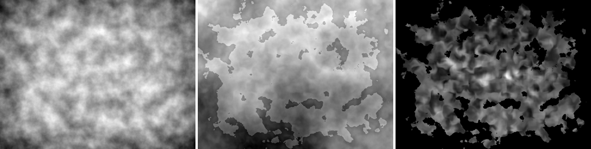
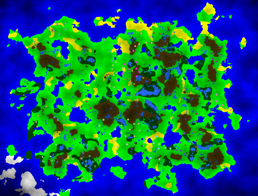

# PWG: procedural world generation

A small, Dwarf-Fortress-like world generator in C++. It builds a continent from layered noise, adds oceans, mountains, rivers, a climate with deserts, forests, snow and glaciers, and then lets a few civilizations settle and spread over the land. Every world comes from a seed, so the same seed always gives the same map and history.



*Seed 42 after 25 years. Squares are towns, coloured by civilization.*

| height · temperature · moisture (seed 42) | another seed (7) |
|---|---|
|  |  |

## Build

You need a C++17 compiler and zlib. [SFML](https://www.sfml-dev.org/) 2.5+ or 3 is needed for the viewer only. [doctest](https://github.com/doctest/doctest) is needed for the tests.

```bash
sudo apt install libsfml-dev zlib1g-dev doctest-dev   # Debian / Ubuntu

make                 # ProcWorld (viewer + export)
make headless        # ProcWorld-headless, no SFML needed
make test            # unit tests

# or with CMake (builds without the viewer when SFML is missing)
cmake -S . -B build && cmake --build build && ctest --test-dir build
```

## Usage

```bash
./ProcWorld full 42                                    # the original form: layer and seed, opens the viewer
./ProcWorld --seed 42 --years 25 --export map.png --no-window --stats
./ProcWorld --seed 3 --size 1600x1000 --layer temperature
```

| option | meaning |
|---|---|
| `--seed N` | world seed (default 1) |
| `--size WxH` | map size in tiles (default 1024x780) |
| `--layer NAME` | `full`, `height`, `temperature`, `moisture`, `rain`, `wind`, `heat` |
| `--years N` | years of history to simulate before showing or exporting (default 1) |
| `--export FILE.png` | write the map as a PNG |
| `--no-window` | don't open the viewer |
| `--stats` | print the biome shares, rivers and civilizations |

In the viewer:
- keys **1–7** switch the layer
- **left click** prints the tile under the mouse, and any town there
- **right click** advances one year
- **space** makes a new world with a random seed
- **S** saves the current view as a PNG
- **Esc** quits

## How a world is made

Everything lives in the header-only library `include/pwg/`, which has no graphics dependency. Noise comes from [FastNoise](https://github.com/Auburn/FastNoise) (MIT, in `third_party/`).

1. **Height.** Fractal Perlin noise is sunk towards the map edges (`edgeOfWorld`) and normalised to [0, 1].
2. **Oceans and mountains.** Tiles below `waterLevelPercentage` are ocean. Tiles above `mountainLevelPercentage` are mountain.
3. **Rivers.** Sources are random mountain tiles at least `distanceBetweenRivers` apart. Each river steps to its lowest neighbour that is lower than the source and not yet water. It stops at the sea, or forms a lake when it gets stuck. Comparing with the source height, not the current tile, lets rivers cross small dips.
4. **Climate.** Wind, heat and rain are perturbed value-noise fields. Temperature is heat minus wind, altitude and rain. It is colder over the ocean and towards the bottom of the map.
5. **Moisture.** Moisture is rain minus temperature and altitude. Rivers and lakes moisten the land within `riverMoistureRadius` tiles.
6. **Biomes:**
   - The wettest `forestPercentage` of the non-mountain land is forest. The rest is grassland.
   - Dry, warm grassland becomes desert.
   - Cold land gets snow.
   - The coldest tiles freeze to glacier or sea ice.
7. **History:**
   - Civilizations (humans, orcs, elves, dwarfs, halflings) start as single towns on land, `distanceBetweenCivilizations` apart.
   - Towns grow by 10 % a year.
   - A town of population P founds a daughter town with probability exp(−100 / P). The new town sits 25–50 tiles away in a random direction, on land, and away from other towns.

All parameters are in `pwg::Params` (`include/pwg/world.hpp`).

```cpp
#include "pwg/history.hpp"

pwg::Params p;
p.seed = 42;
pwg::World world = pwg::generateWorld(p);
pwg::History history = pwg::spawnCivilizations(world);
for (int y = 0; y < 25; y++) pwg::processYear(world, history);
```
